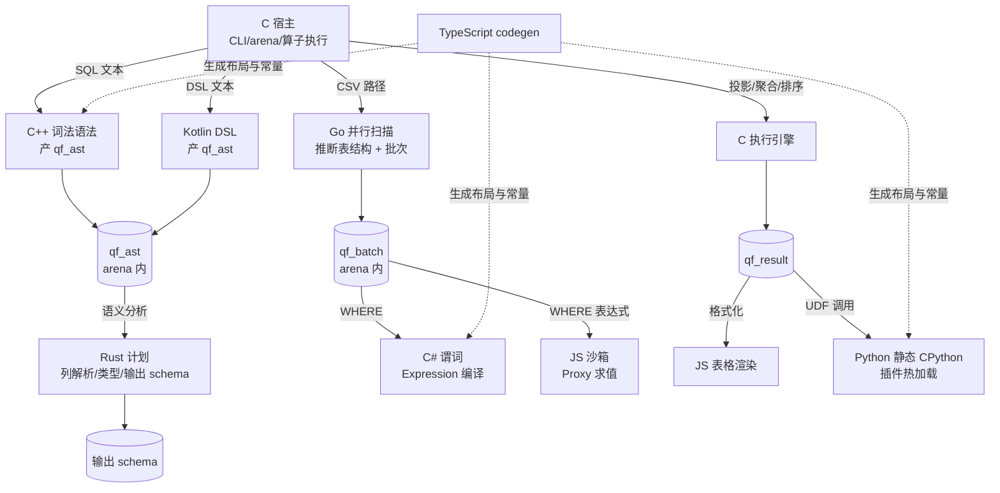

# 架构

一个可执行文件里跑九种语言，唯一的共享物是 `contracts/qf.h`。

## 数据流

## 阶段职责

| 阶段 | 语言 | 职责 | 产物 | 自测 |
|---|---|---|---|---|
| typescript | TS | 布局/错误码/算子编码的单一真相源，生成 C/C#/Python 绑定 | `gen/*` | `stages/typescript/test.sh` |
| c | C | CLI、arena、算子执行、错误呈现 | 宿主源码 | `stages/c/test.sh` |
| cpp | C++ | SQL 词法与语法分析 | `libqf_cpp.a` | `stages/cpp/test.sh` |
| rust | Rust | 列解析、类型检查、输出 schema、ORDER BY 映射 | `libqf_rust.a` | `stages/rust/test.sh` |
| go | Go | CSV 并行扫描与表结构推断 | `libqf_go.a` | `stages/go/test.sh` |
| csharp | C# | WHERE 谓词编译为 Expression 并批量求值 | `qf_cs.lib` | `stages/csharp/test.sh` |
| kotlin | Kotlin | DSL 前端与协程批处理 | `libqf_kt.a` | `stages/kotlin/test.sh` |
| python | Python | UDF 插件热加载（静态 CPython） | `qf_py.obj` | `stages/python/test.sh` |
| javascript | JS | 结果表格渲染与 `--where` 沙箱 | `libqf_js.a` | `stages/js/test.sh` |

> 链接状态：C / C++ / Rust / Go / JS 已进入默认链接；Kotlin 开发中；C# 与 Python 产物可独立构建并通过自测，但因 MSVC/MinGW CRT 边界未参与默认链接，见 `docs/adr/0007-msvc-static-libs-not-default-linked.md`。

## 所有权与生命周期

- **arena 独占**：所有跨语言分配都经 `qf_host.alloc`；没有任何语言持有自己的长期内存。查询结束由宿主一次性释放。
- **文本 = (ptr, len)**：不以 NUL 结尾为契约，C 侧打印时才补长度。
- **不跨边界传异常**：C++ 异常与 Rust panic 必须在阶段内捕获并转成 `qf_err` + 诊断。
- **错误码稳定、文案可变**：端到端测试只断言错误码，不断言中文文本。

## 构建链

1. `codegen/gen.ts` 生成绑定。
2. 各阶段 `build.sh` 产出静态库（MSVC 只用于 C#/CPython）。
3. MinGW gcc 统一链接成 `dist/queryforge.exe`，缺失阶段由 `stages/stubs/stubs.c` 提供 `QF_ERR_UNSUPPORTED` 占位。
4. `tests/e2e/run.sh` 用 Python 标准库 `sqlite3` 做权威对照。
